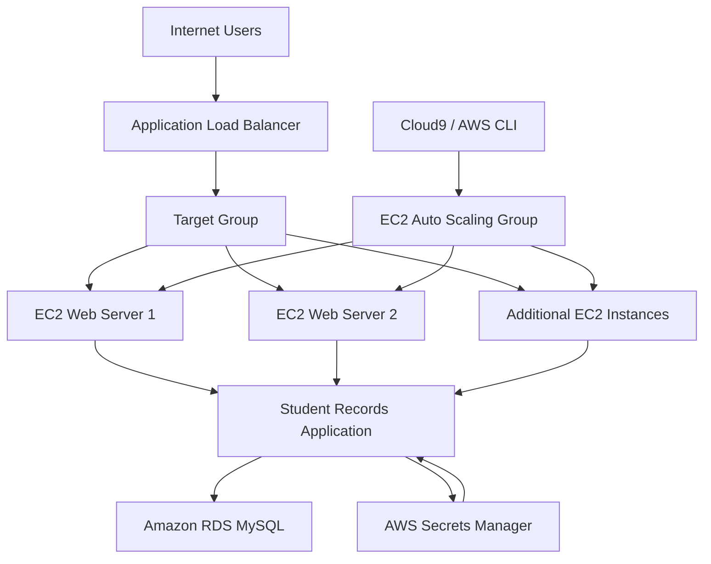

# Building a Highly Available, Scalable Web Application on AWS

## 1. Project Overview

This project focuses on designing and deploying a highly available, scalable, secure, and cost-optimized web application using Amazon Web Services (AWS).

The scenario involves Example University, whose student records application experiences slow response times and service interruptions during peak admission periods due to increased user traffic.

The objective is to design and implement a cloud architecture that improves application performance, distributes incoming traffic across multiple web servers, automatically scales computing resources, and separates the application and database layers.

The final solution uses AWS networking, compute, database, load balancing, auto scaling, and identity and access management services to deliver a resilient web application capable of handling variable workloads.

## 2. Project Objectives

- Design an AWS architecture following relevant AWS Well-Architected Framework principles.
- Deploy a functional student records web application.
- Configure a Virtual Private Cloud (VPC) with appropriate public and private subnets.
- Separate the web application and database infrastructure.
- Deploy and configure Amazon RDS for MySQL.
- Implement secure database credential management using AWS Secrets Manager.
- Distribute incoming traffic using an Application Load Balancer.
- Implement automatic scaling using Amazon EC2 Auto Scaling.
- Configure appropriate security groups and IAM permissions.
- Test application functionality, availability, and scalability.
- Estimate infrastructure costs using AWS Pricing Calculator.

## 3. AWS Services and Technologies

| Service | Purpose |
|---|---|
| [Amazon VPC](https://docs.aws.amazon.com/vpc/)| Provides an isolated virtual network for the application infrastructure. |
| [Amazon EC2](https://docs.aws.amazon.com/ec2/) | Hosts the web application on Ubuntu instances. |
| [Amazon RDS (MySQL)](https://docs.aws.amazon.com/rds/) | Provides managed relational database infrastructure. |
|[Application Load Balancer](https://docs.aws.amazon.com/elasticloadbalancing/) | Distributes incoming application traffic across web servers. |
| [Amazon EC2 Auto Scaling](https://docs.aws.amazon.com/autoscaling/ec2/) | Automatically adjusts the number of web server instances based on demand. |
| [AWS Secrets Manager](https://docs.aws.amazon.com/secretsmanager/) | Securely stores and manages database credentials. |
| [AWS IAM](https://docs.aws.amazon.com/iam/) | Controls permissions and access between AWS services. |
| [AWS Cloud9](https://docs.aws.amazon.com/cloud9/) | Provides a cloud-based environment for executing AWS CLI commands. |
| [AWS CLI](https://docs.aws.amazon.com/cli/) | Supports infrastructure configuration, automation, and testing. |

**Technologies:** Ubuntu Linux, JavaScript, MySQL, AWS CLI, and Markdown.

## 4. System Architecture

The architecture evolves through four implementation phases, beginning with a single EC2 instance and progressing towards a load-balanced, automatically scaling infrastructure.

### Project Implementation

The project is organized into four implementation phases:

| Phase | Description |
|---|---|
| Phase 1: Planning and Design | Architecture diagram and 12-month cost estimation. |
| Phase 2: Basic Application | Deploy a functional web application on a single EC2 instance. |
| Phase 3: Decoupled Architecture | Separate the web server and database using EC2 and Amazon RDS. |
| Phase 4: High Availability and Scalability | Implement Application Load Balancer, EC2 Auto Scaling, and load testing. |

### Architecture Diagram


*Figure 1: AWS architecture illustrating the application, networking, database, security, and scalability components.*

**Architecture considerations:**

- A public-facing Application Load Balancer receives incoming HTTP requests.
- The ALB distributes traffic across EC2 web servers in multiple Availability Zones.
- EC2 instances host the student records application.
- An Auto Scaling group manages the number of application instances.
- Amazon RDS hosts the MySQL database in a private network.
- Security groups restrict communication between infrastructure components.
- AWS Secrets Manager stores database credentials.
- IAM instance roles provide application instances with authorized access to AWS services.

**Deployment Region:** `us-east-1` (US East – N. Virginia).

## 5. Application Architecture Flow

The following diagram illustrates the logical flow of requests through the final architecture.



### 6. Request Processing

1. Users access the application through the internet.
2. The Application Load Balancer receives incoming HTTP requests.
3. The load balancer distributes requests across healthy EC2 instances.
4. The student records application processes user operations.
5. The application retrieves or modifies student records in Amazon RDS.
6. Database credentials are retrieved securely through AWS Secrets Manager using the EC2 instance's IAM role.
7. Auto Scaling adjusts the number of application instances according to configured scaling policies.

### 7. Cost Management

AWS resources may incur charges depending on the services deployed and their usage.

To manage costs:

- Monitor the remaining AWS Academy lab budget.
- Use appropriately sized EC2 and RDS instances.
- Avoid leaving unnecessary resources running.
- Review resource consumption throughout implementation.
- End the lab session when you finish working.

**Important:** AWS Academy lab budgets are subject to restrictions. Exceeding the allocated budget can result in account deactivation and loss of project resources.

## 8. Security Considerations

The project incorporates several security controls:

- Database isolation through private subnets.
- Security groups restricting access to authorized resources.
- IAM roles for controlled access between AWS services.
- AWS Secrets Manager for database credential protection.
- Restricted database connectivity to the application layer.

**Note:** This is a proof-of-concept project. Public application access without authentication and the absence of HTTPS are explicit assignment assumptions, not recommended production configurations.

## 9. Repository Structure

```text
Building-a-Highly-Available-Scalable-Web-Application/
│
├── README.md
│
├── architecture/
│   └── architecture.png
│
├── phase-01-planning/
│   ├── architecture-design.md
│   └── cost-estimation.md
│
├── phase-02-basic-application/
│   ├── vpc-configuration.md
│   ├── ec2-deployment.md
│   └── testing.md
│
├── phase-03-decoupled-architecture/
│   ├── rds-configuration.md
│   ├── secrets-manager.md
│   ├── iam-configuration.md
│   ├── database-migration.md
│   └── testing.md
│
├── phase-04-high-availability/
│   ├── load-balancer.md
│   ├── auto-scaling.md
│   ├── load-testing.md
│   └── validation.md
│
├── scripts/
│
└── screenshots/
    ├── phase-01/
    ├── phase-02/
    ├── phase-03/
    └── phase-04/
```

## 10. Expected Project Outcomes

Upon completion, the project demonstrates the ability to:

- Design cloud infrastructure using AWS architecture principles.
- Configure virtual networking and subnet isolation.
- Deploy and manage Linux-based EC2 instances.
- Deploy and integrate managed relational databases.
- Implement IAM roles and service permissions.
- Manage application secrets securely.
- Configure application load balancing.
- Implement automatic scaling.
- Perform application functionality and load testing.
- Estimate and manage cloud infrastructure costs.

## 11. Future Improvements

The following enhancements could extend the proof of concept towards a production-ready architecture:

- Implement HTTPS using AWS Certificate Manager.
- Introduce authentication and authorization for application users.
- Enable Amazon RDS Multi-AZ deployment.
- Implement database backups and recovery procedures.
- Introduce AWS WAF for application-layer protection.
- Integrate Amazon CloudWatch monitoring and alarms.
- Implement centralized logging and alerting.
- Introduce infrastructure as code using AWS CloudFormation or Terraform.
- Establish automated application deployment through CI/CD pipelines.
- Evaluate disaster recovery and multi-region architecture.

## 12. Learning Outcomes

This project provides practical experience in designing, deploying, securing, and scaling cloud-hosted web applications.

It demonstrates how individual AWS services can work together to address real-world infrastructure challenges involving application availability, performance, security, and scalability.

The progression from a single-server deployment to a decoupled, load-balanced, and automatically scaling architecture provides practical exposure to cloud engineering and infrastructure design.

## 13. References

- [AWS Well-Architected Framework](https://aws.amazon.com/architecture/well-architected/)
- [AWS Architecture Center](https://aws.amazon.com/architecture/)
- [AWS Documentation](https://docs.aws.amazon.com/)
- [AWS Pricing Calculator](https://calculator.aws/)

## 14. License

This project is developed as part of an AWS Academy learning assignment. Refer to the original AWS Academy project materials for applicable usage and licensing terms.